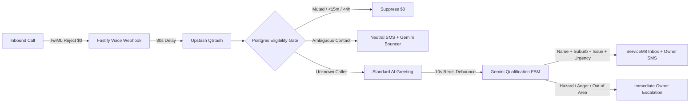

# Tradie AI Receptionist & Eligibility Engine
Event-driven, multi-tenant missed-call SMS receptionist. Built to solve a common bottleneck for sole-trader tradespeople: losing inbound work while on the tools, without risking an automated bot texting personal contacts or quoting jobs sight-unseen.
Intercepts missed calls at zero voice-toll cost, filters out personal contacts and spam before invoking an LLM, qualifies genuine leads over multi-turn SMS, and syncs structured job briefs directly into **ServiceM8**.

## End-to-End Request Flow

## Key Engineering & Hardening Decisions
* Zero-Cost Gate: Deterministic PostgreSQL checks suppress muted numbers, repeat calls within 15 minutes, and active SMS threads within 4 hours before any outbound message or AI call fires.
* Personal Contact Firewall: Ambiguous contacts receive a neutral human-sounding SMS. If Gemini classifies their reply as personal, the bot silences itself permanently, forwards the message to the tradie, and generates a single-use 1-tap magic mute link (/m/:token).
* 10-Second Burst Debouncing: Rapid-fire customer texts and MMS photos are buffered in Upstash Redis using a monotonic debounceVersion token paired with QStash delayed workers, stitching multi-message bursts into a single coherent LLM turn.
* State Machine & Offline Fallback: Enforces a strict 2D transition matrix with progress-based stall tracking (3-strike ultimatum, 4-strike silent abandonment), emergency/000 hazard detection, and a deterministic regex fallback if the Gemini API is unreachable.
* Multi-Tenant Isolation: Tenant trade rules, excluded services, and emergency triage advice are managed in Sanity CMS and read-through cached in Redis (1h TTL) keyed by virtual phone number.

## Tech Stack
* Runtime & API: Node.js, TypeScript, Fastify (hosted on Vercel)
* Messaging & Queues: Twilio (Voice/SMS/MMS), Upstash QStash, Upstash Redis
* Database & CMS: Neon PostgreSQL, Drizzle ORM, Sanity CMS
* AI & Integrations: Gemini 2.5 Flash (Structured Outputs), ServiceM8 REST API

## Deep-Dive Documentation
* **[System Architecture & Data Model](./spec/ARCHITECTURE.md)** — End-to-end sequence diagrams, Eligibility & FSM state machines, and PostgreSQL/Redis schemas.
* **[Business Rules Specification](tradie-ai-business-rules.md)** — Complete register of telephony ingress rules (`TEL`), qualification quorum (`LOD`), safety/pricing guardrails (`SAF`), anti-loop rules (`ABS`), and integrations (`INT`).
* **[Telemetry & Analytics](./spec/TELEMETRY.md)** — Architecture specification for structured logging, trace correlation, and client ROI analytics.
