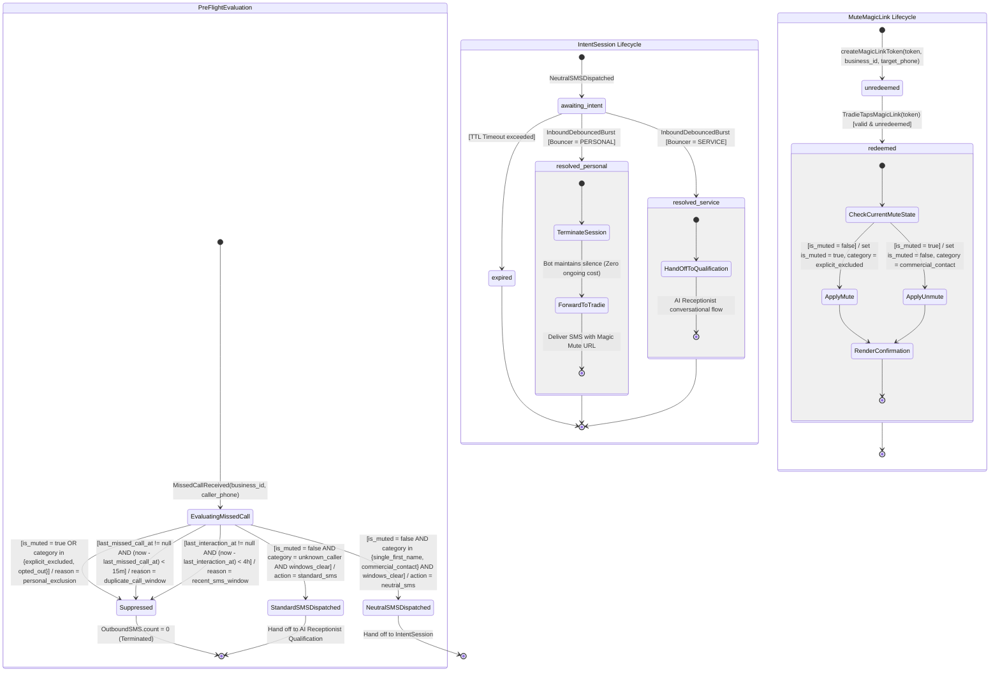
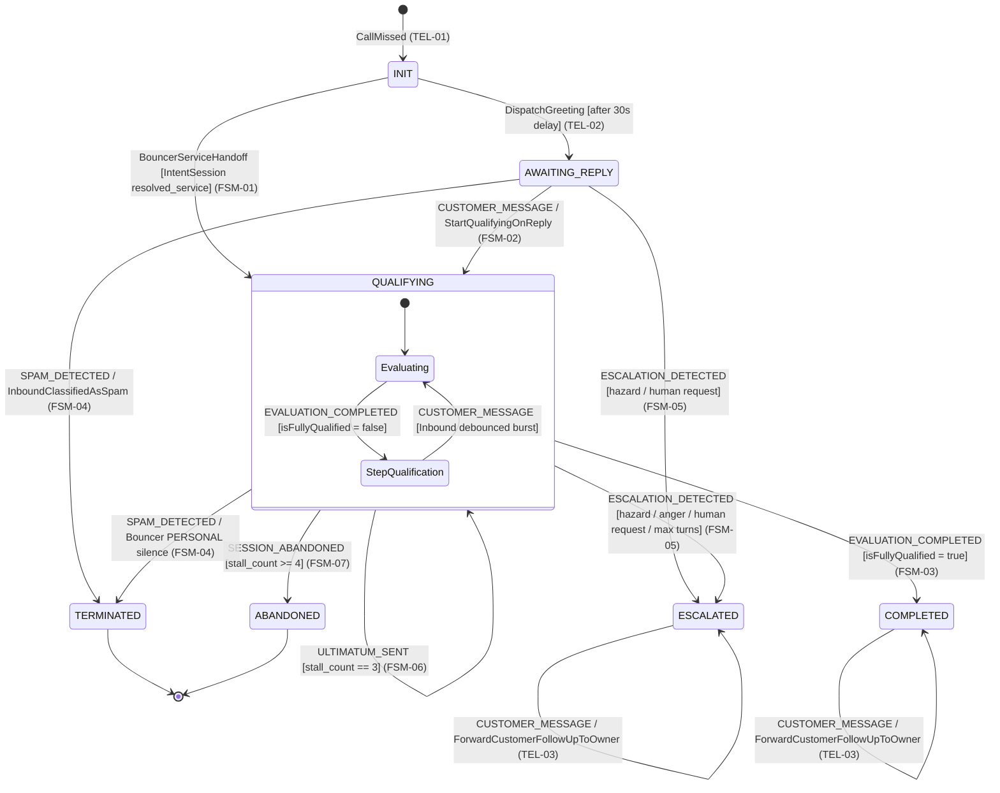
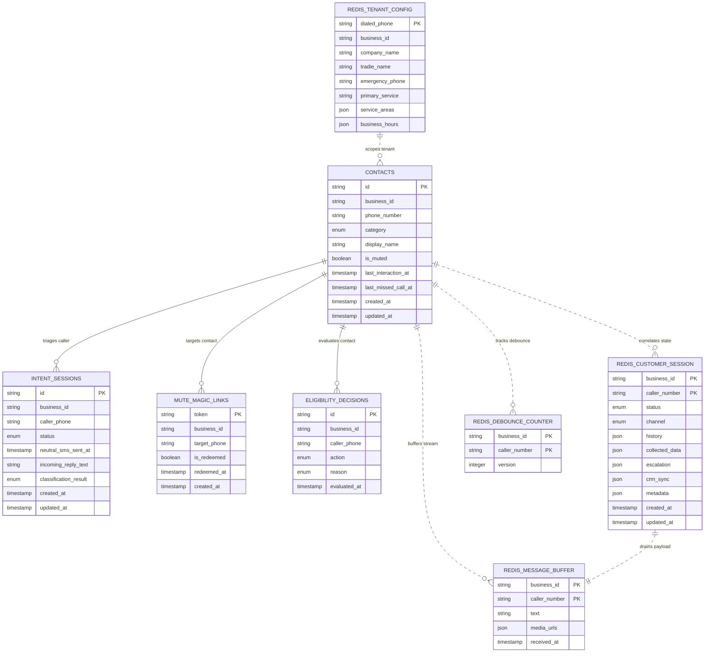

# System Architecture

## 1. System Overview & End-to-End Request Flow

The Tradie AI Receptionist & Eligibility Engine is an event-driven, multi-tenant microservice engineered to capture inbound customer leads, eliminate phone tag, protect tradies from personal contact leakage, and automate job intake into Field Service Management (FSM) software.

### System Capabilities Summary

- **Zero-Toll Missed Call Interception:** Inbound Twilio voice calls on the business virtual number immediately return `<Response><Reject /></Response>`, disconnecting callers with zero carrier toll charges before publishing a delayed job into QStash.
- **Pre-Flight 3-Tier Contact Suppression ($0 Cost Gate):** Deterministic Postgres evaluation stops automated SMS spam before invocation of LLMs or downstream APIs:
  - *Tier 1 (Explicit Exclusion & Mute):* Permanently mutes personal contacts, friends, family, and opt-outs.
  - *Tier 2 (Temporal Duplicate Guard):* Suppresses repeat missed calls from the same caller within a 15-minute window.
  - *Tier 3 (Active Interaction Guard):* Suppresses automated text-backs if active SMS communication occurred within the prior 4 hours.
- **10-Second SMS Burst Debouncing:** Multi-message customer bursts (e.g. typing short consecutive texts or attaching MMS photos) are buffered in Upstash Redis. A monotonic `debounceVersion` key paired with QStash 10-second delayed triggers drains and stitches the batch into a single coherent conversational turn.
- **Gemini Bouncer (Personal vs. Service Triage):** When an ambiguous or single-first-name contact responds to a neutral greeting, an isolated Gemini Flash classifier identifies personal intent versus service enquiries. Personal replies immediately silence the bot, terminate the session, and forward the message to the tradie's private mobile with a 1-tap permanent mute link.
- **Single-Use Magic-Link Muting (`/m/:token`):** Cryptographically random single-use tokens rendered in tradie alert notifications allow the business owner to permanently mute or unmute any phone number in Postgres with a single tap, rendering instant mobile-friendly confirmation UI.
- **Multi-Turn Structured Lead Qualification:** Manages a deterministic Finite State Machine (FSM) backed by Upstash Redis and Gemini Flash to extract mandatory job parameters (customer name, suburb, issue description, and urgency), enforcing a 3-strike anti-loop ultimatum before abandoning uncooperative sessions.
- **Immediate Hazard & Emergency Escalation:** Real-time extraction detects hazards, active water leaks, electrical sparking, or explicit requests for human contact, bypassing conversational intake to trigger high-priority SMS alerts to the tradie.
- **Dual-Channel Lead Dispatch (ServiceM8 + Owner SMS):** Fully qualified leads trigger transactional REST job creation in ServiceM8 and simultaneous formatted SMS dispatch to the business owner containing complete job specs and sync status.

---

### End-to-End Sequence Diagram

```mermaid
sequenceDiagram
    autonumber
    actor Caller
    participant Twilio
    participant FastifyRoutes as Fastify Routes
    participant UpstashRedis as Upstash Redis
    participant QStash
    participant Dispatcher as Message Dispatcher Worker
    participant EligibilityEngine_PG as Eligibility Engine (Postgres)
    participant GeminiAI as Gemini AI
    participant ServiceM8
    actor TradieOwner as Tradie Owner

    %% -------------------------------------------------------------
    %% MISSED CALL PATH
    %% -------------------------------------------------------------
    rect rgb(24, 32, 47)
    note over Caller, Dispatcher: Flow A: Inbound Missed Call Interception & Eligibility Gate
    Caller->>Twilio: Inbound Voice Call
    Twilio->>FastifyRoutes: POST /api/webhooks/twilio/voice (CallSid, From, To)
    FastifyRoutes->>QStash: publishJSON(delay: 30s, deduplicationId: CallSid)
    FastifyRoutes-->>Twilio: 200 OK with TwiML <Reject/>
    Twilio-->>Caller: Call Rejected (Zero Toll Charge)

    note over QStash, Dispatcher: 30-Second Ring/Callback Window Elapses
    QStash->>Dispatcher: POST /api/workers/process-message (MISSED_CALL)
    Dispatcher->>EligibilityEngine_PG: evaluateMissedCall(businessId, callerNumber)

    alt Action: SUPPRESS (Muted, Opted-out, or Recent Interaction < 15m/4h)
        EligibilityEngine_PG-->>Dispatcher: Decision: suppress (personal_exclusion / duplicate_window)
        note over Dispatcher: Terminate execution with zero SMS cost ($0 Gate)
    else Action: NEUTRAL_SMS (Ambiguous / Known Uncertain Contact)
        EligibilityEngine_PG-->>Dispatcher: Decision: neutral_sms
        Dispatcher->>Twilio: sendSms(Neutral Greeting: "Tied up, can I pass on a message?")
        Twilio-->>Caller: Delivery Neutral SMS
        Dispatcher->>EligibilityEngine_PG: createMagicLinkToken(token, callerNumber)
        Dispatcher->>EligibilityEngine_PG: saveIntentSession(status: "awaiting_intent")
    else Action: STANDARD_SMS (Unknown Caller / Verified Lead Flow)
        EligibilityEngine_PG-->>Dispatcher: Decision: standard_sms
        Dispatcher->>UpstashRedis: transition(DISPATCH_GREETING) & saveSession()
        Dispatcher->>Twilio: sendSms("Hi, on the tools right now. How can we help?")
        Twilio-->>Caller: Delivery Standard Greeting SMS
    end
    end

    %% -------------------------------------------------------------
    %% INBOUND SMS PATH
    %% -------------------------------------------------------------
    rect rgb(28, 39, 32)
    note over Caller, Dispatcher: Flow B: Inbound Customer SMS & Debounced Intake
    Caller->>Twilio: Sends SMS / MMS ("Pipe leaking under sink", Photos)
    Twilio->>FastifyRoutes: POST /api/webhooks/twilio/sms (MessageSid, Body, MediaUrl)
    FastifyRoutes->>UpstashRedis: ingestMessage(businessId, callerNumber, text, mediaUrls)
    UpstashRedis-->>FastifyRoutes: return debounceVersion = N
    FastifyRoutes->>QStash: publishJSON(delay: 10s, debounceVersion: N)
    FastifyRoutes-->>Twilio: 200 OK with empty TwiML <Response/>

    note over QStash, Dispatcher: 10-Second Debounce Window Elapses
    QStash->>Dispatcher: POST /api/workers/process-message (INBOUND_SMS, debounceVersion: N)
    Dispatcher->>UpstashRedis: drainIfLatest(businessId, callerNumber, debounceVersion)

    alt Stale Debounce Trigger (Newer message reset buffer version)
        UpstashRedis-->>Dispatcher: return null (Stale version)
        note over Dispatcher: Drop task silently (Subsequent trigger will process combined batch)
    else Valid Debounce Trigger (Customer finished typing)
        UpstashRedis-->>Dispatcher: return combinedText & mediaUrls
        Dispatcher->>UpstashRedis: getOrCreateSession()
        Dispatcher->>EligibilityEngine_PG: getIntentSession(businessId, callerNumber)

        opt IntentSession Status == "awaiting_intent" (Bouncer Triage)
            Dispatcher->>GeminiAI: GeminiBouncerClassifier.classify(combinedText)
            alt Bouncer Result == PERSONAL
                GeminiAI-->>Dispatcher: Classification: PERSONAL
                Dispatcher->>EligibilityEngine_PG: createMagicLinkToken(token)
                Dispatcher->>Twilio: sendSms(TradieOwner: "[Personal Chat]: <Text> | Mute: /m/:token")
                Twilio-->>TradieOwner: Forward Personal Message
                Dispatcher->>EligibilityEngine_PG: muteContact(businessId, callerNumber)
                Dispatcher->>EligibilityEngine_PG: saveIntentSession(status: "resolved_personal")
                Dispatcher->>UpstashRedis: setSessionStatus("TERMINATED")
                note over Dispatcher: Bot silenced permanently for active thread
            else Bouncer Result == SERVICE
                GeminiAI-->>Dispatcher: Classification: SERVICE
                Dispatcher->>EligibilityEngine_PG: saveIntentSession(status: "resolved_service")
                note over Dispatcher: Proceed to Lead Receptionist FSM qualification
            end
        end

        opt Lead Qualification Loop (Service Intent)
            Dispatcher->>GeminiAI: GeminiQualificationEvaluator.evaluate(history, combinedText)
            GeminiAI-->>Dispatcher: Evaluation: extractedFields, isFullyQualified, isEscalated

            alt Scenario 1: Immediate Hazard / Escalation Detected
                Dispatcher->>UpstashRedis: transition(ESCALATION_DETECTED)
                Dispatcher->>Twilio: sendSms(Caller: "Flagged for team lead, contacting shortly.")
                Twilio-->>Caller: Deliver Escalation Notice
                Dispatcher->>Twilio: sendSms(TradieOwner: "EMERGENCY ESCALATION: <Details>")
                Twilio-->>TradieOwner: Deliver Urgent Escalation SMS
            else Scenario 2: Information Missing (Incomplete Qualification)
                Dispatcher->>UpstashRedis: transition(CUSTOMER_MESSAGE) & update collectedData
                Dispatcher->>Twilio: sendSms(Caller: followUpQuestion)
                Twilio-->>Caller: Request Remaining Fields (Name / Suburb / Details)
            else Scenario 3: Lead Fully Qualified (Name, Suburb, Issue Collected)
                Dispatcher->>UpstashRedis: transition(EVALUATION_COMPLETED) -> status: COMPLETED
                Dispatcher->>ServiceM8: POST /job.json (Create Job, Attach Client & Job Notes)
                ServiceM8-->>Dispatcher: 200 OK (Job UUID)
                Dispatcher->>Twilio: sendSms(Caller: "Thanks! We've logged your request and will be in touch.")
                Twilio-->>Caller: Confirmation SMS
                Dispatcher->>Twilio: sendSms(TradieOwner: "NEW LEAD: <Name>, <Suburb>, <Issue> [ServiceM8 Synced]")
                Twilio-->>TradieOwner: Deliver Lead Notification SMS
            end
            Dispatcher->>UpstashRedis: saveSession(currentSession)
        end
    end
    end

    %% -------------------------------------------------------------
    %% MAGIC MUTE PATH
    %% -------------------------------------------------------------
    rect rgb(38, 28, 44)
    note over TradieOwner, FastifyRoutes: Flow C: 1-Tap Magic Mute Execution
    TradieOwner->>FastifyRoutes: GET /m/:token (Clicks link from SMS notification)
    FastifyRoutes->>EligibilityEngine_PG: redeemMagicLinkToken(token)
    EligibilityEngine_PG->>EligibilityEngine_PG: Atomic Redeem: Toggle isMuted & Mark is_redeemed = true
    EligibilityEngine_PG-->>FastifyRoutes: Result: success, targetPhone, actionTaken ("muted" / "unmuted")
    FastifyRoutes-->>TradieOwner: Renders Dark-Mode Confirmation Page ("Contact Muted / Unmuted")
    end
```

## 2. Eligibility Engine & Bouncer State Machine

The Eligibility Engine operates as a deterministic, zero-cost pre-flight gatekeeper preceding conversational LLM qualification. It enforces contact hygiene, suppression windows, and personal relationship firewalls to prevent unwanted outbound SMS dispatches, protect customer relationships, and minimize token costs.

### 2.1 State Architecture & Lifecycles

---

### 2.2 Pre-Flight Suppression & Bouncer Rules Table

| Rule ID | Rule Name | Trigger | Guard Conditions (`requires`) | System Actions & Side Effects (`ensures`) |
| :--- | :--- | :--- | :--- | :--- |
| `R-PRE-01` | **Suppress Muted or Excluded Caller** | `MissedCallReceived(business_id, caller_phone)` | `contact.is_muted == true`  OR `contact.category in {explicit_excluded, opted_out}` | `EligibilityDecision.action = suppress` `EligibilityDecision.reason = personal_exclusion` `OutboundSMS.count = 0` ($0 cost gate). |
| `R-PRE-02` | **Suppress Duplicate Call Window (15m)** | `MissedCallReceived(business_id, caller_phone)` | `contact.last_missed_call_at != null` AND `(now - contact.last_missed_call_at) < 15m` | `EligibilityDecision.action = suppress` `EligibilityDecision.reason = duplicate_call_window` `OutboundSMS.count = 0`. |
| `R-PRE-03` | **Suppress Recent SMS Window (4h)** | `MissedCallReceived(business_id, caller_phone)` | `contact.last_interaction_at != null` AND `(now - contact.last_interaction_at) < 4h` | `EligibilityDecision.action = suppress` `EligibilityDecision.reason = recent_sms_window` `OutboundSMS.count = 0`. |
| `R-PRE-04` | **Dispatch Neutral SMS for Uncertain Contact** | `MissedCallReceived(business_id, caller_phone)` | `contact.is_muted == false` AND `contact.category in {single_first_name, commercial_contact}` AND `(last_missed_call_at == null OR elapsed >= 15m)` AND `(last_interaction_at == null OR elapsed >= 4h)` | `contact.last_missed_call_at = now` `EligibilityDecision.action = neutral_sms` `EligibilityDecision.reason = known_contact_uncertain` Sends neutral bridging SMS. Creates `IntentSession(status: awaiting_intent)`. Generates `MuteMagicLink` token. |
| `R-PRE-05` | **Dispatch Standard SMS for Unknown Caller** | `MissedCallReceived(business_id, caller_phone)` | `contact.is_muted == false` AND `(contact == null OR contact.category == unknown_caller)` AND `(last_missed_call_at == null OR elapsed >= 15m)` AND `(last_interaction_at == null OR elapsed >= 4h)` | `contact.last_missed_call_at = now` `EligibilityDecision.action = standard_sms` `EligibilityDecision.reason = unknown_caller` Upserts contact as `unknown_caller`. Triggers `AIReceptionist.start_qualification`. |
| `R-BNC-01` | **Bouncer Classifies Personal Reply** | `InboundDebouncedBurst(business_id, caller_phone, full_text)` | `IntentSession.status == awaiting_intent` AND `IntentSession.caller_phone == caller_phone` AND `Classifier.classify(full_text) == PERSONAL` | `IntentSession.status = resolved_personal` `IntentSession.classification_result = personal` `CustomerSession.status = terminated` `Bot.maintain_silence = true` ($0 bot cost). Generates single-use `MuteMagicLink`. Forwards SMS to tradie with 1-tap mute link footer. |
| `R-BNC-02` | **Bouncer Classifies Trade Service Reply** | `InboundDebouncedBurst(business_id, caller_phone, full_text)` | `IntentSession.status == awaiting_intent` AND `IntentSession.caller_phone == caller_phone` AND `Classifier.classify(full_text) == SERVICE` | `IntentSession.status = resolved_service` `IntentSession.classification_result = service` Hands caller off to `AIReceptionist.hand_off_to_qualification`. |
| `R-LNK-01` | **Dynamic Magic Link Mute** | `TradieTapsMagicLink(token)` | `MuteMagicLink.token == token` AND `MuteMagicLink.is_redeemed == false` AND `target_contact.is_muted == false` | `MuteMagicLink.is_redeemed = true` `target_contact.is_muted = true` `target_contact.category = explicit_excluded` Renders dark-mode "Contact Muted" confirmation page. |
| `R-LNK-02` | **Dynamic Magic Link Unmute** | `TradieTapsMagicLink(token)` | `MuteMagicLink.token == token` AND `MuteMagicLink.is_redeemed == false` AND `target_contact.is_muted == true` | `MuteMagicLink.is_redeemed = true` `target_contact.is_muted = false` `target_contact.category = commercial_contact` (prevents future auto-mute). Renders dark-mode "Contact Unmuted" confirmation page. |

## 3. AI Receptionist Conversation FSM

The AI Receptionist Conversation Finite State Machine governs multi-turn conversational intake over SMS. It handles debounced inbound message bursts, orchestrates Gemini 2.0 Flash qualification with an offline deterministic heuristic fallback, enforces strict anti-loop boundaries, triages life-safety hazards, and executes terminal dispatches to ServiceM8 and business owner channels.

### 3.1 Conversation State Diagram (`mermaid`)

---

### 3.2 Qualification, Stall & Escalation Rules Table

| Rule / Behavior | Active State(s) | Trigger / Condition | State Mutation & Side Effects |
| :--- | :--- | :--- | :--- |
| **Greeting Dispatch** (`TEL-02`) | `INIT` | `GreetingTimerFires(session)` after 30s missed-call timer | Transitions to `AWAITING_REPLY`. Updates `metadata.lastOutboundAt`. Sends opening greeting SMS: *"Hi, this is [tradie]'s assistant. He's on the tools right now. How can we help you today?"* |
| **Bouncer Service Handoff** (`FSM-01`) | `INIT` | `InboundDebouncedBurst` AND `IntentSession.status == resolved_service` | Transitions directly to `QUALIFYING` (skipping the 30s greeting SMS). Initializes `turn_count = 1`, `user_message_count = 1`, `stall_count = 0`. Dispatches payload immediately to qualification evaluation. |
| **Start Qualification** (`FSM-02`) | `AWAITING_REPLY` | `CUSTOMER_MESSAGE` (Inbound debounced burst received) | Transitions to `QUALIFYING`. Increments `turn_count` and `user_message_count`. Updates `metadata.lastInboundAt`. Dispatches burst text to Gemini or offline fallback evaluator. |
| **Multi-Turn Step Qualification** (`FSM-02`) | `QUALIFYING` | `EVALUATION_COMPLETED` AND `isFullyQualified == false` | Remains in `QUALIFYING`. Merges newly extracted fields (`customerName`, `suburb`, `issue`, `urgency`, `mediaUrls`) into `collectedData`. • If **any** qualification field progressed: resets `stall_count = 0`. • If **no** fields progressed: increments `stall_count += 1`. Sends targeted single-question follow-up SMS (`followUpQuestion`). |
| **Mandatory Qualification Gate** (`FSM-03`) | `QUALIFYING` | All 4 required fields present: 1. `customerName != null` 2. `suburb != null` 3. `issue != null` 4. `urgency in {LOW, MEDIUM, HIGH, EMERGENCY}` | Evaluator sets `isFullyQualified = true`. Triggers completion flow. |
| **Complete Qualification & Dispatch** (`FSM-03`) | `QUALIFYING` | `EVALUATION_COMPLETED` AND `isFullyQualified == true` | Transitions to `COMPLETED`. Latches state. • Executes `DISPATCH_LEAD_TO_SERVICEM8` (REST API job sync, `crmSync.status = PENDING`). • Executes `DISPATCH_LEAD_TO_OWNER` (SMS alert with full job specs). • Sends `SEND_COMPLETION_SMS` to customer with on-site inspection and upfront quote framing (no sight-unseen fix promises). |
| **Anti-Loop Warning Ultimatum** (`FSM-06`) | `QUALIFYING` | `StalledTurnEvaluated` AND `stall_count == 3` | Remains in `QUALIFYING`. Fires `ULTIMATUM_SENT` event. Bypasses LLM generation and fires hardcoded `SEND_ULTIMATUM_SMS` detailing exact missing parameters (e.g. name or suburb) required to proceed. |
| **Anti-Loop Stall Abandonment** (`FSM-07`) | `QUALIFYING` | `StalledTurnEvaluated` AND `stall_count >= 4` | Transitions to `ABANDONED` (terminal sink). Fires `SESSION_ABANDONED` event. Bot enforces complete radio silence; worker silently drops all future webhooks for this session ($0 cost). |
| **Max Turn Boundary Escalation** (`FSM-05`) | `QUALIFYING` | `turn_count > MAX_TURNS` (exceeded allowable conversational turns) | Transitions to `ESCALATED` with reason `MAX_TURNS_EXCEEDED`. Halts AI qualification. Emits `ALERT_OWNER_ESCALATION` with collected conversation transcript. |
| **Hazard & Emergency Escalation** (`FSM-05`) | `AWAITING_REPLY`, `QUALIFYING` | Gas leak, sparking electrical wires, active flood, or life hazard (`DANGER_HAZARD`) | Transitions immediately to `ESCALATED`. Sets `escalation.reason = DANGER_HAZARD`. • Generates single-use `MuteMagicLink` token. • Sends immediate high-priority SMS alert to business owner with hazard details, action prompt, and magic mute link. • Sends customer safety SMS instructing them to isolate utility/call 000 if life-threatening. |
| **Anger & Human Request Escalation** (`FSM-05`) | `AWAITING_REPLY`, `QUALIFYING` | Explicit demand for human (`HUMAN_REQUEST`), profanity/frustration (`ANGER`), or out-of-scope trade/area (`OUT_OF_BOUNDS`) | Transitions to `ESCALATED`. Latches session. Sends high-priority SMS alert to owner with magic link. Sends customer bridging SMS: *"No problem — I have flagged this for the team lead directly."* Halts AI receptionist automation. |
| **Spam & Personal Silence** (`FSM-04`) | `AWAITING_REPLY`, `QUALIFYING` | Intent evaluated as `solicitation` or `spam`, or Bouncer resolves `PERSONAL` | Transitions to `TERMINATED` (terminal sink). Emits `TERMINATE_SILENTLY`. Sends zero outbound SMS messages ($0 cost gate). Rejects all subsequent inbound transitions. |
| **Offline Heuristic Fallback** | `QUALIFYING` | Gemini API unavailable, network failure, or `GEMINI_API_KEY` missing | Transparently invokes `evaluateOffline()`. Extracts parameters via deterministic regex/heuristics: • Suburb: Australian service area matching. • Urgency: High-frequency trade distress tokens (`burst`, `leak`, `urgent`, `flood`). • Name: Regex pattern `(?:name is\|i'm\|i am\|call me)\s+([a-z]+)`. Maintains conversation continuity without crashing or dropping leads. |
| **Post-Completion Latching Relay** (`TEL-03`) | `COMPLETED`, `ESCALATED` | `CUSTOMER_MESSAGE` received on latched session | Session status is preserved (`COMPLETED` or `ESCALATED`). Bot maintains strict radio silence toward the customer. Emits `FORWARD_UNHANDLED_TO_OWNER`, piping customer's raw text and media URLs directly to the business owner's mobile. |

## 4. PostgreSQL & Redis Data Model

The microservice employs a hybrid tiered storage architecture:
1. **Neon PostgreSQL (Serverless Relational Engine):** Serves as the system of record for long-term audit trails, pre-flight contact categorization, intent triage state, dynamic single-use mute links, and eligibility suppression logs.
2. **Upstash Redis (Serverless In-Memory Key-Value Store):** Serves as the high-throughput, low-latency ephemeral cache for conversational FSM session state, multi-message burst debouncing, monotonic version tokens, and tenant configuration caching.

---

### 4.1 Entity-Relationship & Cache Correlation Diagram

The following diagram maps all persistent PostgreSQL tables alongside the ephemeral Upstash Redis data structures, detailing primary/foreign keys, attributes, and cross-system correlation via `business_id` and caller/recipient phone numbers.

---

### 4.2 Storage Ownership, TTL & Isolation Reference Table

| Store | Table / Key Pattern | Owner Machine | TTL / Retention | Purpose & Isolation Boundary |
| :--- | :--- | :--- | :--- | :--- |
| **Neon PostgreSQL** | `contacts` | Pre-Flight Eligibility Engine (`EligibilityEngine`) & Magic Link Route (`/m/:token`) | Permanent (System of Record) | **Writes:** `EligibilityEngine` upserts interaction timestamps (`last_missed_call_at`, `last_interaction_at`) and inserts initial contact profiles; `/m/:token` toggles `is_muted` and mutates `category` (`explicit_excluded` vs. `commercial_contact`). **Reads:** Pre-flight suppression queries (`is_muted`, `category`, suppression windows). **Boundary:** Multi-tenant isolated via `(business_id, phone_number)` composite unique index. |
| **Neon PostgreSQL** | `intent_sessions` | Bouncer Triage Service (`IntentClassifier` / Dispatcher) | Permanent (Audit Trail) | **Writes:** Dispatcher creates records when dispatching neutral greetings for ambiguous callers (`awaiting_intent`) and latches terminal triage (`resolved_personal`, `resolved_service`, `expired`). **Reads:** Inbound SMS webhook to verify whether incoming caller is currently completing neutral bouncer triage. **Boundary:** Scoped by `(business_id, caller_phone)` lookup index. |
| **Neon PostgreSQL** | `mute_magic_links` | Dispatcher Worker (`process-message.worker.ts`) & Webhook Route | Permanent (Single-Use Audit) | **Writes:** Created during escalation or personal bouncer alerts with cryptographically secure random token slugs (`token`). Redeemed via single-use tap (`is_redeemed = true`, `redeemed_at = NOW()`). **Reads:** Fastify GET `/m/:token` route validates link validity before mutating contact record. **Boundary:** Keyed by unique `token` PK; scoped per business and target phone. |
| **Neon PostgreSQL** | `eligibility_decisions` | Pre-Flight Eligibility Engine (`EligibilityEngine`) | Permanent (Compliance & Audit Log) | **Writes:** `EligibilityEngine` appends an immutable audit log entry for every inbound missed-call evaluation (`standard_sms`, `neutral_sms`, `suppress`) with deterministic reason. **Reads:** Telemetry, audit verification, and suppression rate reporting. **Boundary:** Scoped by `(business_id, caller_phone)` and indexed by `evaluated_at`. |
| **Upstash Redis** | `session:{biz}:{phone}` | AI Receptionist FSM (`SessionStore` / `StateMachine`) | `86400s` (24 Hours Rolling Expiration) | **Writes:** `SessionStore.saveSession()` serializes conversational context, turn counts, extracted lead entities, escalation flags, and CRM sync status. **Reads:** Inbound message processing worker restores session on every debounced SMS turn. **Fallback:** In-memory `Map<string, SessionState>` when Redis credentials are not configured. **Boundary:** Strict per-customer conversational boundary isolated by tenant ID and E.164 phone. |
| **Upstash Redis** | `buffer:{biz}:{phone}` | Message Ingestion Buffer (`MessageBufferManager`) | `60s` (Rolling Safety Expiration) | **Writes:** Fastify inbound SMS route appends incoming texts and MMS URLs via Redis `RPUSH`. **Reads:** Drained and wiped via `LRANGE` and `DEL` inside `MessageBufferManager.drainIfLatest()`. **Fallback:** In-memory `Map<string, BufferedMessage[]>` for offline/dev operation. **Boundary:** Ephemeral list isolated to customer burst window. |
| **Upstash Redis** | `debounce:{biz}:{phone}` | Debounce Gatekeeper (`MessageBufferManager`) | `60s` (Rolling Safety Expiration) | **Writes:** Atomically incremented via Redis `INCR` on each inbound message arrival. **Reads:** Worker compares trigger `debounceVersion` against current Redis version token; drops execution if a newer message has arrived. **Fallback:** In-memory `Map<string, number>`. **Boundary:** Ephemeral version counter per customer. |
| **Upstash Redis** | `tenant:config:{phone}` | Cached Tenant Provider (`CachedTenantProvider`) | `3600s` (1 Hour Expiration) | **Writes:** Cached on read-through cache miss after resolving from Sanity CMS source-of-truth. **Reads:** Ingest webhook routes (`/webhook/twilio-voice`, `/webhook/twilio-sms`, `/webhook/telnyx`) resolve tenant metadata by dialed virtual number. **Fallback:** In-memory `Map<string, { tenant, expiresAt }>` fallback. **Boundary:** Isolated by clean E.164 virtual phone number. |