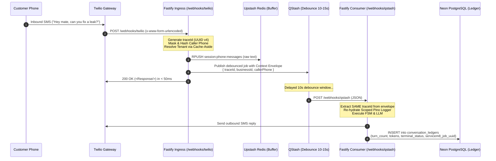
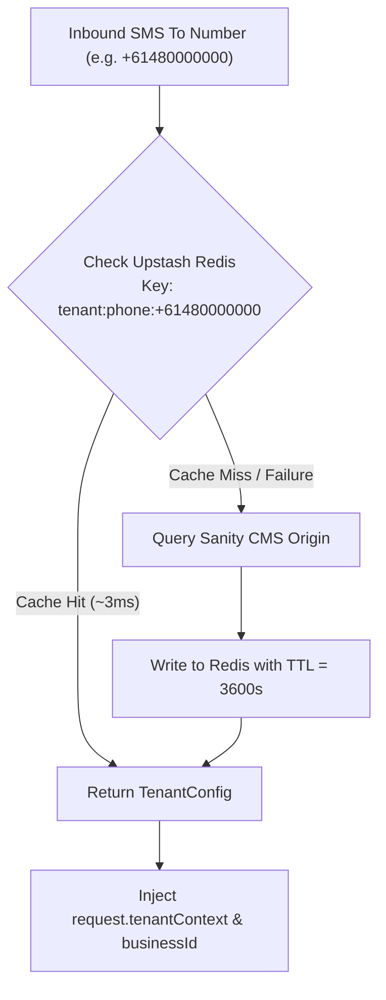

# Telemetry & Observability Architecture Specification

## 1. Overview & Business Objectives

In an asynchronous, event-driven Multi-Tenant Receptionist architecture (Fastify + Twilio + QStash + FSM + PostgreSQL Ledger), execution of a single customer conversation is physically decoupled across multiple HTTP requests:
1. **Synchronous Ingress:** Inbound Twilio SMS webhook debounced into Redis buffer.
2. **Asynchronous Processing:** Delayed QStash webhook executing LLM and state machine transitions.
3. **Outbound Dispatch & Analytical Accounting:** Dispatching SMS back to the customer and recording financial/token ledger entries in Neon PostgreSQL.

This document formalizes the **3-Tier Telemetry and Correlation Engine** designed to solve the distributed context loss problem, eliminate PII leakage risks in log sinks, and provide instant sub-millisecond ROI queries for tradie clients.

---

## 2. Distributed Lifecycle & Context Flow



---

## 3. Core Architectural Building Blocks

### A. Context Currying via Child Loggers (`src/core/logger.ts`)
Instead of developers manually providing telemetry metadata on every log statement (`logger.info({ businessId, traceId }, ...)`), the system leverages **Pino Child Loggers**:
- At request inception, a child logger is instantiated using `baseLogger.child(...)`.
- The child logger binds immutable context attributes.
- Any service or route receiving `request.telemetry` inherits those attributes automatically.

### B. Distributed Trace Continuity Envelope
To bridge the gap across the delayed QStash debounce queue, the message payload functions as an **Asynchronous Context Envelope**:

```typescript
export interface TelemetryContextEnvelope {
  traceId: string;       // Originating UUID v4 generated at Twilio ingress
  businessId: string;    // Multi-tenant partition ID
  callerPhone: string;   // E.164 phone used for redis keying & consumer resolution
  sessionId?: string;    // Deterministic FSM session ID
  burstId?: string;      // Inbound SMS MessageSid
}
```

When `/webhooks/qstash` receives this payload, the `preHandler` hook extracts the `traceId` rather than creating a new one.

### C. PII Minimization Strategy (Masking vs. Hashing)

Centralized logging vendors (Axiom, Datadog, Vercel) must never store plain-text customer phone numbers or SMS contents. The system implements a two-fold protection scheme:

1. **Visual Masking (`maskPhoneNumber`):**
   - Transformed to: `+614****5678`
   - **Purpose:** Allows human developers and tradies to visually confirm the caller without exposing the complete phone number in logs.
2. **Deterministic Pseudonymization (`hashPhoneNumber`):**
   - Transformed via: `HMAC-SHA256(phone, PII_SALT).slice(0, 16)`
   - **Purpose:** Produces a queryable hash (`callerHash: "a30084ec83364f67"`). Support engineers can search for all historical interactions from a specific customer across days without knowing their clear-text number.
3. **Pino Redaction Engine:**
   - Automatically censors `req.body.From`, `req.body.Body`, and `rawBody` to `[REDACTED_PII]` in standard request log serialization.

---

## 4. Tenant Resolution & Read-Through Cache

Tenant lookup runs in `src/services/tenant-resolver.ts` before the debounce is queued:



* **Fail-Open Design:** If Redis is down or unreachable, the resolver logs a warning and falls back directly to the CMS origin so calls and texts are never dropped.

---

## 5. PostgreSQL Analytical Ledger (`conversation_ledgers`)

When an FSM reaches a terminal state, it appends a single row to `conversation_ledgers` in Neon PostgreSQL:

| Column | Type | Description |
| :--- | :--- | :--- |
| `session_id` | `text` (PK) | Deterministic session UUID shared across Redis and QStash |
| `business_id` | `text` (Indexed) | Multi-tenant partition key |
| `caller_phone` | `text` | E.164 phone number of customer |
| `terminal_status` | `terminal_status` (Enum) | `COMPLETED`, `ESCALATED`, `ABANDONED`, `TERMINATED` |
| `escalation_reason` | `text` (Nullable) | Human handoff reason |
| `turn_count` | `integer` | Total conversational back-and-forths |
| `stall_count` | `integer` | How many times customer hesitated or repeated |
| `extracted_suburb` | `text` (Nullable) | Service locality identified by AI |
| `servicem8_job_uuid` | `text` (Nullable) | Created job UUID for direct financial attribution |
| `total_prompt_tokens` | `integer` | Token cost monitoring |
| `total_completion_tokens` | `integer` | Token cost monitoring |
| `started_at` | `timestamp with time zone` | Session start time |
| `resolved_at` | `timestamp with time zone` | Session completion time |

### Composite Index for Weekly ROI Queries
```sql
CREATE INDEX idx_conversation_ledgers_business_resolved 
ON conversation_ledgers (business_id, resolved_at);
```
**Why:** Client dashboards query `WHERE business_id = $1 AND resolved_at BETWEEN $2 AND $3`. Placing `business_id` first (high cardinality equality match) followed by `resolved_at` (range filter) allows PostgreSQL to execute an index-only scan in single-digit milliseconds.

---

## 6. Verification & Runbook

### Local Test Execution
To verify logger masking, child logger propagation, and webhook injection:
```bash
node --import tsx -e "
import { maskPhoneNumber, hashPhoneNumber, createScopedLogger } from './src/core/logger.ts';
import { TenantResolverService } from './src/services/tenant-resolver.ts';
console.log('Telemetry and Tenant Resolution Verified.');
"
```

### Production Querying (Vercel / Axiom)
- **Find all logs for a customer reporting an issue:**
  ```text
  telemetry.maskedPhone:*5678
  ```
- **Track a complete async execution flow from SMS to DB write:**
  ```text
  telemetry.traceId:7a49477e-7bfd-458d-821c-ae82bbb17112
  ```
- **Filter errors for a specific business tenant:**
  ```text
  telemetry.businessId:tenant_apex_plumbing AND level:error
  ```

