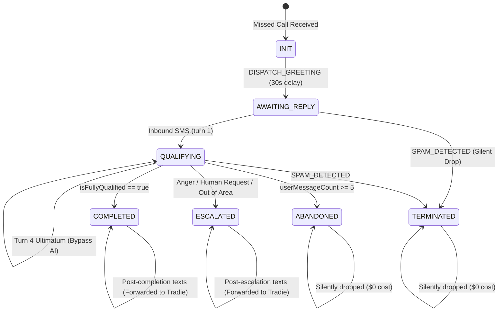

# Tradie AI Receptionist: Business Rules Specification

This document serves as the authoritative, standalone business rules register for the **Tradie AI Receptionist** microservice. It defines the operational boundaries, conversational policies, safety guardrails, state transitions, and integration triggers enforced across the codebase.

---

## 1. Telephony & Entry Ingress Rules

| Rule ID | Rule Name | Description & Specification | Enforcement Location |
| :--- | :--- | :--- | :--- |
| **TEL-01** | **Zero-Cost Voice Intercept** | Inbound missed phone calls must immediately respond with a TwiML `<Response><Reject /></Response>`. The call is rejected at carrier level before billing connects, incurring \$0 telephony voice minutes. | [`src/routes/twilio-voice.route.ts`](file:///c:/Users/caleb/OneDrive/Documents/Micro-service/src/routes/twilio-voice.route.ts) |
| **TEL-02** | **Delayed Missed-Call Greeting** | Rejected voice calls schedule a **30-second delayed** job via Upstash QStash before dispatching the opening SMS. This delay gives the caller time to take the phone away from their ear and see an incoming SMS notification naturally. | [`src/routes/twilio-voice.route.ts`](file:///c:/Users/caleb/OneDrive/Documents/Micro-service/src/routes/twilio-voice.route.ts) |
| **TEL-03** | **Immediate SMS Ingress 200 OK** | Inbound SMS webhooks must immediately return an empty TwiML `<Response></Response>` with HTTP 200 within 500ms to satisfy Twilio's timeout policy, and enqueue the event into QStash asynchronously. | [`src/routes/twilio-sms.route.ts`](file:///c:/Users/caleb/OneDrive/Documents/Micro-service/src/routes/twilio-sms.route.ts) |
| **TEL-04** | **Static Persona Greeting** | The initial SMS dispatched to a caller must be assumption-free and establish an AI assistant persona:  `"Hi, this is [Tradie Name]'s assistant. He's on the tools right now. How can we help you today?"` | [`src/routes/process-message.worker.ts`](file:///c:/Users/caleb/OneDrive/Documents/Micro-service/src/routes/process-message.worker.ts) |
| **TEL-05** | **Multi-Message Debounce Buffer** | Inbound SMS streams in rapid succession (e.g. "hey", "need a new system", "in Blackwood") are buffered in Redis (`buffer:{business}:{caller}`) with an incrementing version token. Evaluation is debounced with a **10-second rolling window**. If a newer text arrives during the window, previous timer versions are dropped. Once 10s elapses with silence, all buffered texts are concatenated into a single prompt turn. | [`src/core/message-buffer.ts`](file:///c:/Users/caleb/OneDrive/Documents/Micro-service/src/core/message-buffer.ts) & [`src/routes/twilio-sms.route.ts`](file:///c:/Users/caleb/OneDrive/Documents/Micro-service/src/routes/twilio-sms.route.ts) |

---

## 2. Lead Qualification & Data Extraction Rules

| Rule ID | Rule Name | Description & Specification | Enforcement Location |
| :--- | :--- | :--- | :--- |
| **LOD-01** | **Mandatory Lead Quorum** | A lead is defined as **`isFullyQualified: true`** ONLY when all four prerequisites are collected:  1. `customerName` (explicitly stated, never fabricated) 2. `suburb` (verified location) 3. `issue` (specific work/problem) 4. `urgency` (`LOW`, `MEDIUM`, `HIGH`, or `EMERGENCY`) | [`src/core/gemini-evaluator.ts`](file:///c:/Users/caleb/OneDrive/Documents/Micro-service/src/core/gemini-evaluator.ts) & [`src/core/state-machine.ts`](file:///c:/Users/caleb/OneDrive/Documents/Micro-service/src/core/state-machine.ts) |
| **LOD-02** | **Natural Non-Interrogation** | The AI must never prompt the customer with a multi-item checklist. In each turn, it must identify the single most critical missing field and ask for it conversationally in 1–2 short sentences. | [`src/core/gemini-evaluator.ts`](file:///c:/Users/caleb/OneDrive/Documents/Micro-service/src/core/gemini-evaluator.ts) |
| **LOD-03** | **Implicit Urgency Inference** | The AI must natively infer urgency from customer vocabulary (e.g. "flooding", "burst pipe", "sewage overflowing", "smell of gas" $\to$ `HIGH` or `EMERGENCY`; "dripping tap", "quote next week" $\to$ `LOW`). It must never ask the customer to self-rate low/medium/high. | [`src/core/gemini-evaluator.ts`](file:///c:/Users/caleb/OneDrive/Documents/Micro-service/src/core/gemini-evaluator.ts) |
| **LOD-04** | **No Hallucinated Data** | If the caller has not provided their name or suburb, the LLM must leave those properties `undefined` in tool parameters. It must never use placeholders like "John Doe" or assume a location. | [`src/core/gemini-evaluator.ts`](file:///c:/Users/caleb/OneDrive/Documents/Micro-service/src/core/gemini-evaluator.ts) |
| **LOD-05** | **Visual Triage (MMS)** | Inbound media URLs (photos/videos sent via MMS) must be preserved in the session history and attached to `collectedData.mediaUrls` to allow tradies to visually inspect issues. | [`src/routes/process-message.worker.ts`](file:///c:/Users/caleb/OneDrive/Documents/Micro-service/src/routes/process-message.worker.ts) |

---

## 3. Operational Safety, Liability & Pricing Guardrails

| Rule ID | Rule Name | Description & Specification | Enforcement Location |
| :--- | :--- | :--- | :--- |
| **SAF-01** | **Universal Danger Protocol (000)** | If an immediately life-threatening hazard is described (gas smell, exposed live power wires, structural collapse, arcing), the AI must immediately output the verbatim warning:  `"For your safety, please isolate the issue if safe to do so, or contact 000 / your utility provider immediately."` | [`src/core/gemini-evaluator.ts`](file:///c:/Users/caleb/OneDrive/Documents/Micro-service/src/core/gemini-evaluator.ts) (Rule 2) |
| **SAF-02** | **Tenant Emergency Triage Injection** | For high-urgency trade issues that are not life-threatening but risk property damage, the AI must inject the tenant's trade-specific advice (e.g. plumbers: *"Locate and shut off the main water valve meter while you wait"*). This advice is pulled dynamically from Sanity CMS, never hardcoded. | [`src/core/providers/cached-tenant.provider.ts`](file:///c:/Users/caleb/OneDrive/Documents/Micro-service/src/core/providers/cached-tenant.provider.ts) |
| **SAF-03** | **Three-Step Pricing Pivot** | The AI must never quote fixed prices, estimate costs, diagnose technical root causes, or provide binding repair commitments over SMS. When asked about pricing:  1. **Acknowledge:** *"Totally understand you want an idea of price."* 2. **State Policy:** *"[Tradie] provides an upfront quote once inspected on-site."* 3. **Pivot:** Immediately ask for the missing qualification detail. | [`src/core/gemini-evaluator.ts`](file:///c:/Users/caleb/OneDrive/Documents/Micro-service/src/core/gemini-evaluator.ts) (Rule 3) |
| **SAF-04** | **Trade Domain Ontology & Exclusions (3-Layer Scope)** | Rather than an exhaustive whitelist, scope is governed in 3 layers:  1. **Blacklist:** Tasks in `excludedServices` (e.g. 'Commercial roofing') are politely declined. 2. **Trade Ontology:** The AI uses domain common sense for the tradie's `tradeType`. (e.g. For plumbers: downpipes, storm water, taps, toilets, gas, hot water, burst pipes, and drains are accepted automatically). 3. **Foreign Trades:** Inquiries for completely different trades (e.g. electrical wiring, tiling, painting) trigger human escalation (`OUT_OF_BOUNDS`). | [`src/core/gemini-evaluator.ts`](file:///c:/Users/caleb/OneDrive/Documents/Micro-service/src/core/gemini-evaluator.ts) (Rule 6) |
| **SAF-05** | **Service Area Boundary** | If the caller's suburb is definitively outside the tenant's configured `serviceArea`, the session must trigger an immediate human escalation with reason `OUT_OF_BOUNDS`. | [`src/core/gemini-evaluator.ts`](file:///c:/Users/caleb/OneDrive/Documents/Micro-service/src/core/gemini-evaluator.ts) (Rule 7) |

---

## 4. Abuse Prevention, Spam & Anti-Loop Rules

| Rule ID | Rule Name | Description & Specification | Enforcement Location |
| :--- | :--- | :--- | :--- |
| **ABS-01** | **Spam / Solicitation Sinkhole** | The AI classifies conversation intent (`customer_lead`, `solicitation`, `spam`). If classified as marketing, SEO sales, bots, or telemarketers:  1. State immediately transitions to **`TERMINATED`**. 2. **Zero outbound SMS is dispatched.** 3. No lead is sent to ServiceM8 or the tradie. 4. Any subsequent webhooks from this number are discarded immediately at Redis read level ($0 compute/telephony). | [`src/core/gemini-evaluator.ts`](file:///c:/Users/caleb/OneDrive/Documents/Micro-service/src/core/gemini-evaluator.ts) & [`src/core/state-machine.ts`](file:///c:/Users/caleb/OneDrive/Documents/Micro-service/src/core/state-machine.ts) |
| **ABS-02** | **Progress-Based Stall Tracking** | Rather than a naive message counter, the worker tracks consecutive turns with zero newly extracted data (`metadata.stallCount`). If a message contains useful data (name, suburb, issue, urgency), `stallCount` resets to 0. | [`src/contracts/session-state.contract.ts`](file:///c:/Users/caleb/OneDrive/Documents/Micro-service/src/contracts/session-state.contract.ts) |
| **ABS-03** | **Stall 3 Hardcoded Ultimatum** | If `stallCount == 3` (3 consecutive unhelpful turns) and the lead remains unqualified, the worker evaluates Gemini first, merges the latest data, and dispatches a concise ultimatum with the *true* remaining missing fields:  `"To get this sorted, I just need [Missing Field 1] and [Missing Field 2]. Can you send that through?"` | [`src/routes/process-message.worker.ts`](file:///c:/Users/caleb/OneDrive/Documents/Micro-service/src/routes/process-message.worker.ts) |
| **ABS-04** | **Stall 4 Silent Abandonment** | If `stallCount >= 4` (4 consecutive unhelpful turns without providing info), the session transitions to **`ABANDONED`**. No further outbound messages are sent, and future webhooks for this session duration are dropped silently ($0 cost). | [`src/routes/process-message.worker.ts`](file:///c:/Users/caleb/OneDrive/Documents/Micro-service/src/routes/process-message.worker.ts) |
| **ABS-05** | **Human Escalation Threshold** | If the caller expresses profanity, severe anger, or explicitly demands a human (e.g. *"let me speak to Caleb"*, *"stop texting me robot"*), the session transitions to **`ESCALATED`**. The AI pauses automation, notifies the tradie with the conversation transcript, and texts the customer: *"No problem! I have alerted the team directly."* | [`src/core/gemini-evaluator.ts`](file:///c:/Users/caleb/OneDrive/Documents/Micro-service/src/core/gemini-evaluator.ts) & [`src/routes/process-message.worker.ts`](file:///c:/Users/caleb/OneDrive/Documents/Micro-service/src/routes/process-message.worker.ts) |

---

## 5. State Machine Lifecycle & Latching Rules

| Rule ID | Rule Name | Description & Specification |
| :--- | :--- | :--- |
| **FSM-01** | **Strict 2D Transition Table** | State changes only occur via the transition matrix ($\delta: Q \times \Sigma \to Q' \times \Omega$). Any unmapped `(State, Event)` combination returns `isTransitionValid: false` and makes no mutations. |
| **FSM-02** | **Greeting Idempotency** | If a second `MISSED_CALL` webhook arrives while in `AWAITING_REPLY` or `QUALIFYING`, it is ignored. No duplicate greetings are ever dispatched. |
| **FSM-03** | **Latching Post-Completion Forwarding** | Once in `COMPLETED` or `ESCALATED`, subsequent texts do not re-run AI evaluation. Instead, they are forwarded verbatim to the tradie's mobile as an alert: `"[Follow-up from {caller}]: {body}"`. |

---

## 6. Integrations & Notification Rules

| Rule ID | Rule Name | Description & Specification |
| :--- | :--- | :--- |
| **INT-01** | **ServiceM8 Inbox Ingestion** | Upon entering `COMPLETED`, the structured lead brief is dispatched via HTTP POST to the ServiceM8 REST API (`/job.json`). The job is placed in the **Inbox** status (unscheduled) so the tradie retains full calendar booking discretion. |
| **INT-02** | **Dual Notification Guarantee** | Regardless of ServiceM8 API status, a high-priority SMS brief is dispatched directly to `BUSINESS_OWNER_PHONE` with the lead summary and the ServiceM8 sync indicator (`✅ In ServiceM8` or `⚠️ ServiceM8 sync failed`). |
| **INT-03** | **Read-Through Tenant Caching** | Tenant trade configurations, services, and triage advice are fetched from Sanity CMS and cached in Upstash Redis (`tradie_ai:tenant:{phone}`) with a 1-hour TTL to maintain sub-50ms worker response times and eliminate CMS read limits. |
| **INT-04** | **Multi-Tenant Redis Isolation** | All Redis keys must strictly follow the project namespacing standard: `tradie_ai:session:{tenant}:{caller}` with a 24-hour rolling TTL to allow cohabitation in single Redis instances. |

